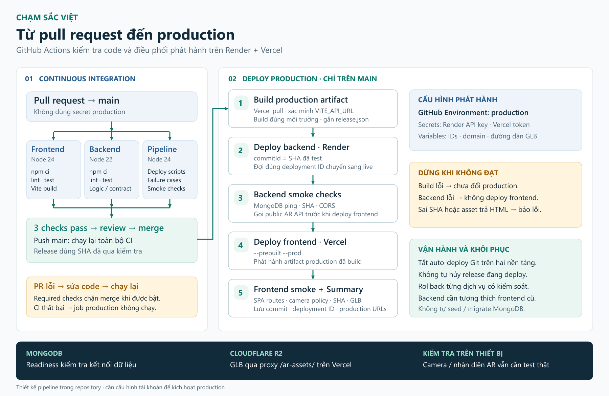

# CI/CD Chạm Sắc Việt

Pipeline: **GitHub Actions → Render API → Vercel CLI**. Workflow thực thi nằm tại [cicd.yml](../../.github/workflows/cicd.yml).



- [Diagram SVG để chèn vào slide](./pipeline.svg)
- [Nguồn diagram Mermaid](./pipeline.mmd)
- [Kịch bản trình bày với mentor, khoảng 6 phút](./mentor-script.md)
- [Biên bản kiểm tra local](./verification.md)

## 1. Pipeline thực hiện những gì?

| Sự kiện | Kiểm tra | Deploy |
| --- | --- | --- |
| Pull request vào `main` | Backend, frontend, script pipeline chạy song song | Không |
| Push/merge vào `main` | Chạy lại toàn bộ kiểm tra trên SHA đã merge | Production nếu mọi job thành công |
| Run workflow thủ công | Chạy toàn bộ kiểm tra | Chỉ deploy khi chọn nhánh `main` |

Ba job CI không sử dụng secret production:

- **Backend checks:** Node `22.22.0`, `npm ci`, lint, Node.js test runner.
- **Frontend checks:** Node `24.22.3`, `npm ci`, lint, `npm test`, Vite production build.
- **Pipeline checks:** kiểm thử cấu hình, Render API orchestration và smoke checks bằng HTTP response giả lập, không gọi deploy thật.

Sau CI, một job **Deploy production** chạy tuần tự:

1. Kiểm tra đủ Secrets/Variables và URL hợp lệ; lỗi cấu hình dừng trước khi thay đổi production.
2. Dùng Vercel CLI ghim phiên bản để lấy cấu hình production từ project; xác minh `VITE_API_URL` khớp backend cần deploy.
3. Build artifact production bằng `vercel build --prod`. Gắn `release.json` chứa SHA vào `.vercel/output/static`.
4. Kiểm tra Render đã tắt auto-deploy, gửi SHA qua `commitId`, theo dõi **deployment ID vừa tạo** tới `live`, xác minh commit Render báo về.
5. Gọi readiness backend, kiểm tra SHA, CORS và public AR API.
6. Deploy artifact lên Vercel với `--prebuilt --prod`.
7. Kiểm tra domain frontend: `/`, `/ar`, `/login`, camera Permissions-Policy, SHA trong `release.json` và phần đầu file GLB qua proxy `/ar-assets/`.
8. Ghi commit, Render deployment ID và hai URL vào GitHub Actions Job Summary. Vercel deployment URL xuất hiện trong log CLI, metadata `releaseCommit` lưu SHA.

Build frontend trong CI kiểm tra source mà không cần secret. Build production chạy riêng sau khi lấy đúng biến môi trường Vercel; đây là hai build có mục đích khác nhau. Vercel không build lại artifact khi nhận `--prebuilt`.

Workflow gọi Vercel CLI tại **repository root**. Project Vercel phải giữ **Root Directory = `frontend`**; không thêm `cd frontend` vào các bước CLI vì có thể áp dụng root directory hai lần.

## 2. Project đang dùng

- Repository: <https://github.com/Zengggggg/cham-sac>
- Vercel: <https://vercel.com/gianggbgt-gmailcoms-projects/cham-sac-aqfv>
- Render service ID: `srv-dbbek00n74is73dtvt40`
- Render: <https://dashboard.render.com/web/srv-dbbek00n74is73dtvt40>
- Backend production: <https://cham-sac-viet-api.onrender.com>

Domain production và Vercel organization/project ID phải lấy từ dashboard. Tên team/project trong URL **không thay thế** cho ID thật. Không suy đoán domain từ tên project.

## 3. Kích hoạt một lần

### GitHub Environment

Vào repository → **Settings → Environments → New environment**, đặt tên `production`. Nếu gói GitHub hỗ trợ, giới hạn deployment branch là `main`. Không bắt buộc thêm người duyệt để pipeline tự chạy sau merge; nếu nhóm bật reviewer thì quy trình có thêm bước phê duyệt.

Thêm **Environment Secrets**:

| Secret | Nguồn |
| --- | --- |
| `RENDER_API_KEY` | Render account/workspace API key có quyền đọc service và tạo/xem deployment |
| `VERCEL_TOKEN` | Vercel token có quyền deploy project đã chọn |

Thêm **Environment Variables**:

| Variable | Giá trị |
| --- | --- |
| `RENDER_SERVICE_ID` | `srv-dbbek00n74is73dtvt40` |
| `VERCEL_ORG_ID` | Team/organization ID trong Vercel settings hoặc `.vercel/project.json` sau khi link |
| `VERCEL_PROJECT_ID` | Project ID trong Vercel project settings |
| `PRODUCTION_BACKEND_URL` | `https://cham-sac-viet-api.onrender.com` |
| `PRODUCTION_FRONTEND_URL` | Domain HTTPS production chính, không dùng deployment preview URL |
| `AR_SMOKE_ASSET_PATH` | `/ar-assets/models/thap-rua/Meshy_AI_turtle_tower_ar_optim_1015064523_texture.glb` hoặc đường dẫn GLB thật đang phục vụ |

Không lưu API key/token trong repository, file tài liệu hay hội thoại. Không cần SSH private key, VM IP, GHCR hay `packages: write` cho pipeline này.

Có thể cấu hình bằng script PowerShell sau khi lấy đủ domain frontend và Vercel IDs:

```powershell
./scripts/setup-cicd.ps1
```

Script dùng GitHub CLI đã đăng nhập, tạo/cập nhật environment và biến công khai, sau đó để `gh secret set` hỏi secret qua prompt tương tác. Không truyền token trong tham số lệnh hoặc ghi vào file. `-SkipSecrets` chỉ cấu hình các biến công khai. Script không tạo token mới, không deploy và không thay đổi dashboard hosting.

### Render

Trong service đã nêu:

1. Giữ Git repository đúng dự án, branch `main`, Root Directory `backend`.
2. Build command `npm ci --omit=dev`, Start command `npm start`, Node `22.22.0`.
3. Đặt **Auto-Deploy = Off**. Workflow sẽ từ chối tạo deploy nếu cấu hình live vẫn bật auto-deploy.
4. Đặt **Health Check Path = `/chamsacviet/health/ready`**. Route này có sau lần deploy code mới đầu tiên; status route cũ vẫn được giữ.
5. Giữ đủ MongoDB/JWT/Resend và các biến nghiệp vụ hiện có. `FRONTEND_URL` phải đúng origin trong `PRODUCTION_FRONTEND_URL`; đồng bộ URL trở về payOS và Google OAuth nếu thay domain.
6. Không tự đặt `RENDER_GIT_COMMIT` bằng một giá trị cố định. Render cung cấp biến này cho commit đang được triển khai; readiness dùng nó để xác nhận phiên bản.

`render.yaml` đã khai báo các thay đổi trên. Service được quản lý bằng Blueprint cần sync Blueprint; service tạo thủ công phải cập nhật tương ứng trong dashboard. Sửa YAML local không tự cập nhật một service live chưa được liên kết/sync.

### Vercel

1. Giữ Root Directory `frontend`, framework Vite, Node.js `24.x`.
2. Build `npm run build`, install `npm ci`, output `dist` theo `frontend/vercel.json`.
3. Trong Environment Variables **Production**, đặt `VITE_API_URL` đúng `PRODUCTION_BACKEND_URL`; thêm `VITE_GOOGLE_CLIENT_ID` nếu bật Google login.
4. `frontend/vercel.json` dùng `git.deploymentEnabled: false` để Git integration không tự deploy song song. Đảm bảo cấu hình này có hiệu lực trên nhánh liên kết khi chuyển sang pipeline mới. Việc chuyển đổi lần đầu có thể còn một deployment Git của commit cấu hình; kiểm tra dashboard, sau đó chạy workflow trên `main`.
5. Pipeline kiểm tra website công khai qua domain production. Nếu production bật Deployment Protection, bổ sung cơ chế automation bypass được nhóm phê duyệt; không tắt bảo vệ chỉ để vượt smoke check.

### Bảo vệ nhánh và chạy lần đầu

1. Commit thay đổi lên nhánh `ci/setup-cicd`, tạo PR vào `main`. Workflow được GitHub phát hiện trong `.github/workflows/`.
2. Sau lần CI đầu, bật yêu cầu các status checks **Backend checks**, **Frontend checks**, **Pipeline checks** trước khi merge. Cấu hình require PR và ngăn push thẳng vào `main` theo quy trình nhóm.
3. Hoàn thành environment và cấu hình hai nền tảng trước khi merge PR. Không tắt auto-deploy sớm khi pipeline chưa sẵn sàng tiếp quản.
4. Merge PR. Pipeline chạy CI trên SHA của `main` rồi deploy; xác minh Summary có cả hai domain và deployment ID.
5. Kiểm tra thủ công WebAR bằng HTTPS trên điện thoại: cấp quyền camera, nhận diện thẻ, mở model. Kiểm tra auth và thanh toán bằng dữ liệu/tài khoản thử nghiệm được phép.

## 4. Kiểm thử local

Dùng phiên bản Node ghi trong `.node-version` của từng dịch vụ:

```powershell
cd backend
npm ci
npm run lint
npm test
```

```powershell
cd frontend
npm ci
npm run lint
npm test
npm run build
```

Tại repository root, Node 24:

```powershell
node --test .github/scripts/tests/*.test.mjs
```

Backend readiness trả HTTP 200 khi MongoDB đã kết nối và trả lời ping trong thời hạn 3 giây; lỗi trả 503 với response contract chung, không lộ lỗi kết nối. Local trả `commitSha: null` khi không có `RENDER_GIT_COMMIT` hợp lệ.

## 5. Xử lý lỗi và rollback

| Lỗi | Hành vi |
| --- | --- |
| Lint/test/build CI thất bại | Job production không chạy |
| Thiếu secret, sai URL, Vercel API origin không khớp, production build lỗi | Dừng trước khi tạo deployment Render |
| Render chưa tắt auto-deploy | Dừng trước khi tạo deployment |
| Render build thất bại hoặc hết thời gian đợi | Không deploy frontend; xem deployment ID trước khi chạy lại |
| Backend trả phiên bản cũ, DB không sẵn sàng hoặc CORS sai | Không deploy frontend |
| Vercel deploy/frontend smoke thất bại | Workflow đỏ; backend có thể đã lên phiên bản mới, frontend có thể đã được cập nhật |

Production được deploy tuần tự, **không phải transaction** giữa hai nền tảng. Backend mới phải tương thích frontend đang chạy. Workflow không tự rollback vì có thể đã phát sinh dữ liệu mới.

Khi cần khôi phục:

1. Ghi nhận SHA/deployment ID cuối cùng tốt từ Actions Summary và dashboard.
2. Nếu chỉ frontend lỗi, dùng Vercel rollback về deployment production tốt gần nhất, xác nhận lại domain và API.
3. Nếu backend lỗi, dùng Render rollback về deployment tốt tương thích. Chạy lại readiness/public API và kiểm tra frontend.
4. Hoặc revert commit lỗi qua PR để pipeline kiểm tra và triển khai lại code đã sửa. Không dùng Run workflow trên commit cũ như một cơ chế rollback ngầm.
5. Migration dữ liệu có kế hoạch khôi phục riêng; rollback code không hoàn tác MongoDB. Không chạy seed hoặc migration tự động trong workflow này.

Không hủy workflow đang deploy production nếu chưa biết trạng thái hai nền tảng. Pipeline chỉ tự hủy các PR run cũ; run production được xếp theo concurrency group. GitHub có thể thay pending run bằng run mới hơn, nên mục tiêu là phát hành commit mới nhất đã qua CI, không đảm bảo mọi commit trung gian đều được deploy.

## 6. Giới hạn và bước phát triển tiếp

- Test backend hiện chủ yếu là unit/service test với mock và Mongoose validation, chưa chứng minh transaction/unique index hoạt động với MongoDB replica set thật. Thêm integration job khi có môi trường test riêng.
- Smoke frontend là HTTP-level: kiểm tra route, marker phiên bản và GLB. Chưa thay thế E2E trình duyệt, Google login, OTP, payOS hay camera/WebAR trên thiết bị.
- Pipeline kiểm tra một asset AR đại diện, không xác minh toàn bộ 9 model. Không tạo đơn, gửi email hay gọi thanh toán thật trong smoke check.
- CI chạy toàn bộ mỗi PR; chưa dùng path filter để tránh bỏ sót thay đổi cấu hình chung hoặc required check bị treo.
- Vercel/Render có thể dùng patch Node khác khi quản lý runtime; CI ghim bản kiểm thử và frontend buộc cùng major 24. Khi nâng runtime/CLI/action, cập nhật pin và kiểm thử lại.
- Chưa có staging. Khi thêm, dùng database, credential và domain riêng; backend hiện chỉ cho phép một `FRONTEND_URL`.

## Tài liệu đối chiếu

- [GitHub Actions workflow location](https://docs.github.com/en/actions/get-started/quickstart)
- [Vercel CLI với GitHub Actions và prebuilt](https://vercel.com/kb/guide/how-can-i-use-github-actions-with-vercel)
- [Vercel Git deployment configuration](https://vercel.com/docs/project-configuration/git-configuration)
- [Render trigger deploy, commitId](https://api-docs.render.com/reference/create-deploy)
- [Render retrieve deployment](https://api-docs.render.com/reference/retrieve-deploy)
- [Render health checks](https://render.com/docs/health-checks)
